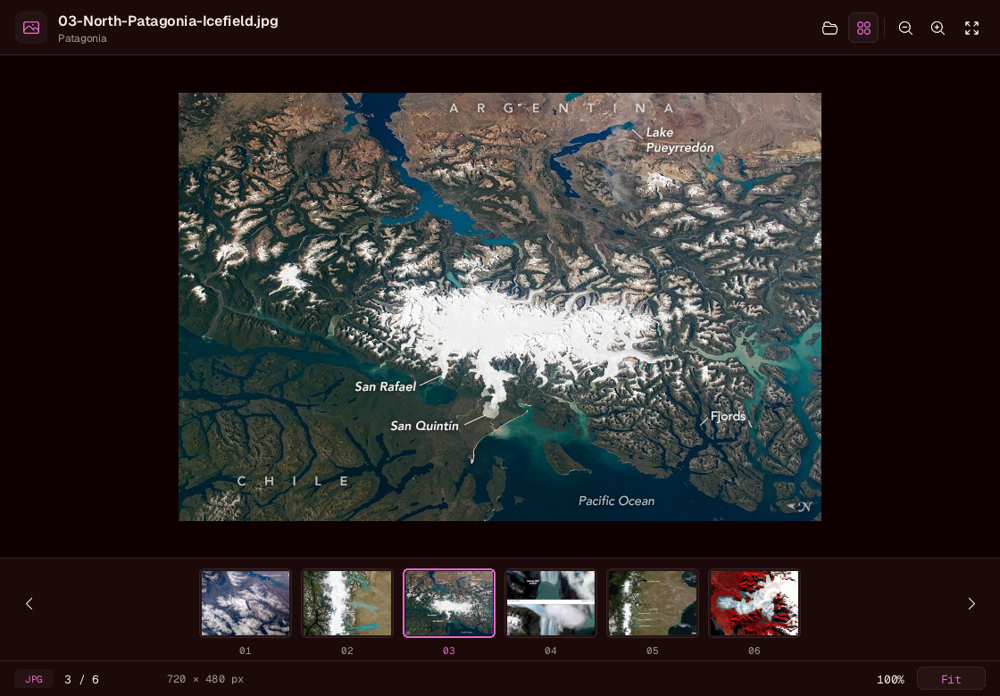
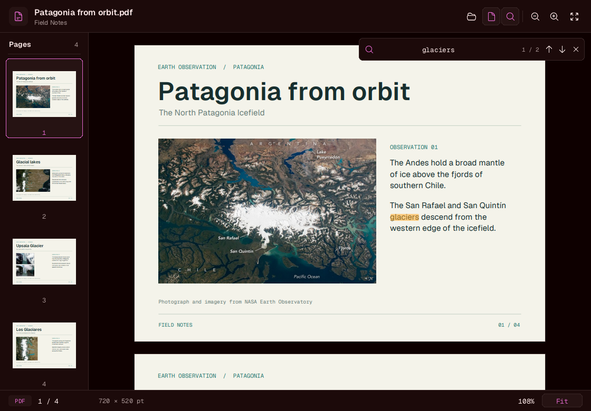

# View

A small Linux/X11 viewer for images and PDFs, built with [CUI](https://github.com/mattmezza/cui). It follows Xresources, ships with Geist and Geist Mono, and exposes a local socket for scripts.





## Install

```sh
curl -fsSL https://raw.githubusercontent.com/mattmezza/view/main/install.sh | sh
```

Pass `--default` to register View as the default handler for PDFs and supported image types.

```sh
curl -fsSL https://raw.githubusercontent.com/mattmezza/view/main/install.sh | sh -s -- --default
```

Run the installer again to upgrade. It verifies the release checksum and installs into `~/.local/bin` and `${XDG_DATA_HOME:-~/.local/share}`. Set `VIEW_BIN_DIR` to change the binary location or `VIEW_VERSION=v0.1.0` to pin a release. Restart View after upgrading a running instance. Release binaries for x86-64 and ARM64 are statically linked. View’s update badge uses `curl` to check GitHub in the background.

## Use

Open a file from the file manager, drop it onto the window, or run `view FILE`. Opening an image adds the other images in its folder to the filmstrip. Opening a folder starts at its first readable image. For a path that begins with a dash or matches a command, use `view -- FILE`.

| Key | Action |
| --- | --- |
| **Ctrl+O** | Open a file or folder |
| **← / →**, **H / L** | Previous or next image or PDF page |
| **↑ / ↓**, **Page Up / Page Down** | Scroll the PDF |
| **F**, **F11**, **Esc** | Toggle or leave fullscreen |
| **G**, **T** | Toggle the gallery or PDF thumbnails |
| **+ / −**, **0**, **1** | Zoom, fit, or actual size |
| **Ctrl+F**, **N / Shift+N** | Find in the PDF and move between matches |
| **Ctrl+C** | Copy selected PDF text |
| **Ctrl+R**, **F1** | Reload settings or show shortcuts |

Drag to pan an image. In a PDF, drag across text to select it and use the middle mouse button to pan. Ctrl+wheel zooms and Shift+wheel pans horizontally. The zoom mode button switches PDF fit and fit-to-width.

View reads PDF, JPEG, PNG, GIF, WebP, AVIF, TIFF, SVG, BMP, TGA, ICO, QOI, PBM, PGM, PPM, PSD composites, and Radiance HDR. Animated images and multipage TIFFs display their first frame or page. SVG uses NanoSVG’s path and shape rendering. HEIC and camera RAW are outside the supported format list.

## Script it

```sh
view open './reports/Quarterly review.pdf'
view goto 3
view find 'cash flow'
view find-next
view zoom 125
view fullscreen on
view status
```

`view open PATH` starts the viewer if needed and returns after the file is accepted or a load error is reported. Other commands target the existing window on the current `DISPLAY`. `view --help` lists the commands. `status` returns JSON with the absolute path, type, one-based index and count, zoom percentage, pane visibility settings, and search state. PDF search runs incrementally. Poll `searching` for completion.

`view --socket` prints the path to the private Unix `SOCK_SEQPACKET` socket. Send one packet containing NUL-terminated UTF-8 arguments, for example `status\0`. The reply is one packet beginning with ASCII `0` for success or `1` for failure, followed by the optional result or error. Packets are limited to 16 KiB. The server checks the peer UID.

## Configure

Copy [view.conf](view.conf) to `${XDG_CONFIG_HOME:-~/.config}/view/config` and reload with Ctrl+R. It lists the font, color, layout, zoom, gallery, thumbnail, update, and key binding settings. Colors use `view.*` Xresources with the wildcard background, foreground, and color4 as fallbacks. `color.*` config entries override Xresources. View follows palette changes from `xrdb` while running.

## Build and install from source

Install a C compiler, Make, Python 3, pkg-config, curl, LLVM’s linker (LLD 22 or later), and the development packages for X11, libwebp, libtiff, and libavif. The build fetches a checksum-pinned PDFium archive.

```sh
make -j
sudo make clean install
```

The source installation uses `/usr/local` by default and installs the executable, desktop entry, and icon. Override `PREFIX` or stage with `DESTDIR`. To make a source install the default viewer for your user, run `view --mime-types | while read -r mime; do xdg-mime default view.desktop "$mime"; done`.

The [release workflow](.github/workflows/release.yml) lists the Ubuntu static build dependencies and runs the X11 smoke test under Xvfb. A release from the current commit on `origin/main` starts that workflow.

```sh
make release name=v0.1.0
```

Each [release](https://github.com/mattmezza/view/releases) gets its binaries, SHA-256 checksums, and third-party notices. The Makefile and release workflow provide the build and relinking instructions. System libraries are sourced from Ubuntu’s [package archive](https://archive.ubuntu.com/ubuntu/pool/).

[MIT](LICENSE). Contributions are closed.

<sub>Screenshot imagery from NASA Earth Observatory. [North Patagonia Icefield](https://science.nasa.gov/earth/earth-observatory/north-patagonia-icefield-southern-andes-149192/), [Los Glaciares](https://science.nasa.gov/earth/earth-observatory/los-glaciares-national-park-argentina-145156/), [Upsala Glacier](https://science.nasa.gov/earth/earth-observatory/glacial-retreat-in-argentina-4186/), [Glacial Lakes of Patagonia](https://science.nasa.gov/earth/earth-observatory/glacial-lakes-of-patagonia-49614/), [Patagonian Glacier](https://science.nasa.gov/earth/earth-observatory/patagonian-glacier-1076/), and [Erosion by Ice and Water in the Southern Andes](https://science.nasa.gov/earth/earth-observatory/erosion-by-ice-and-water-in-the-southern-andes-1034/).</sub>
